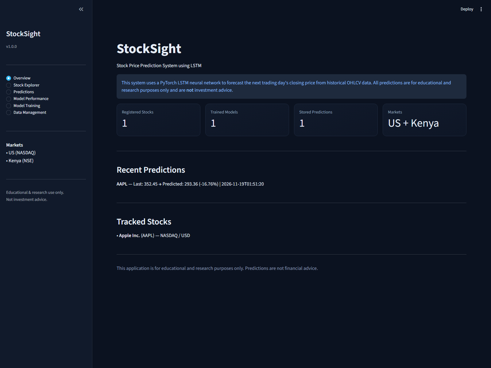
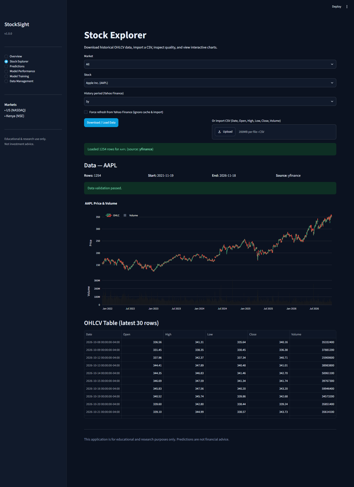
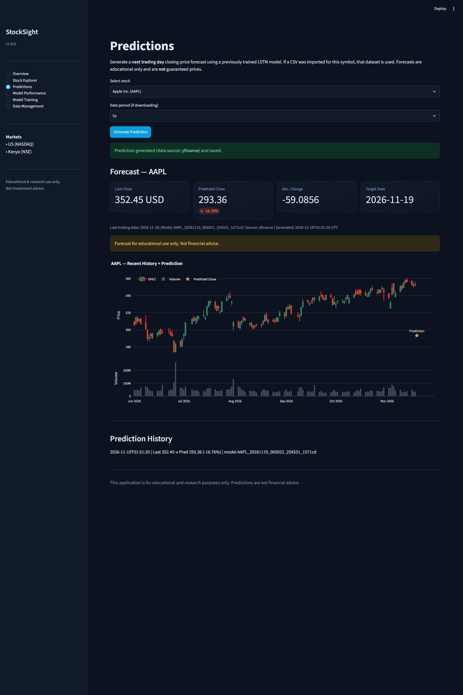
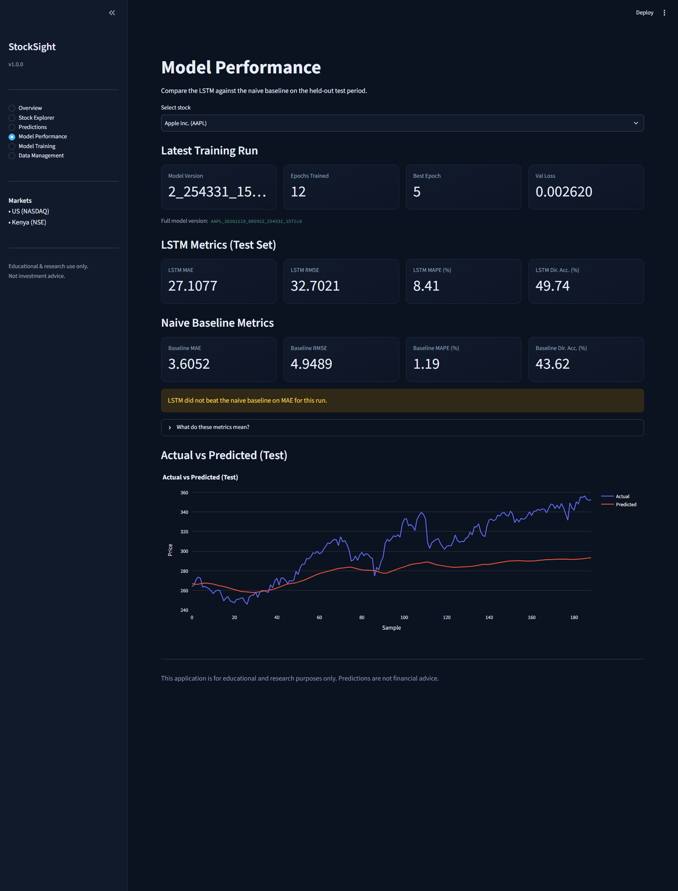
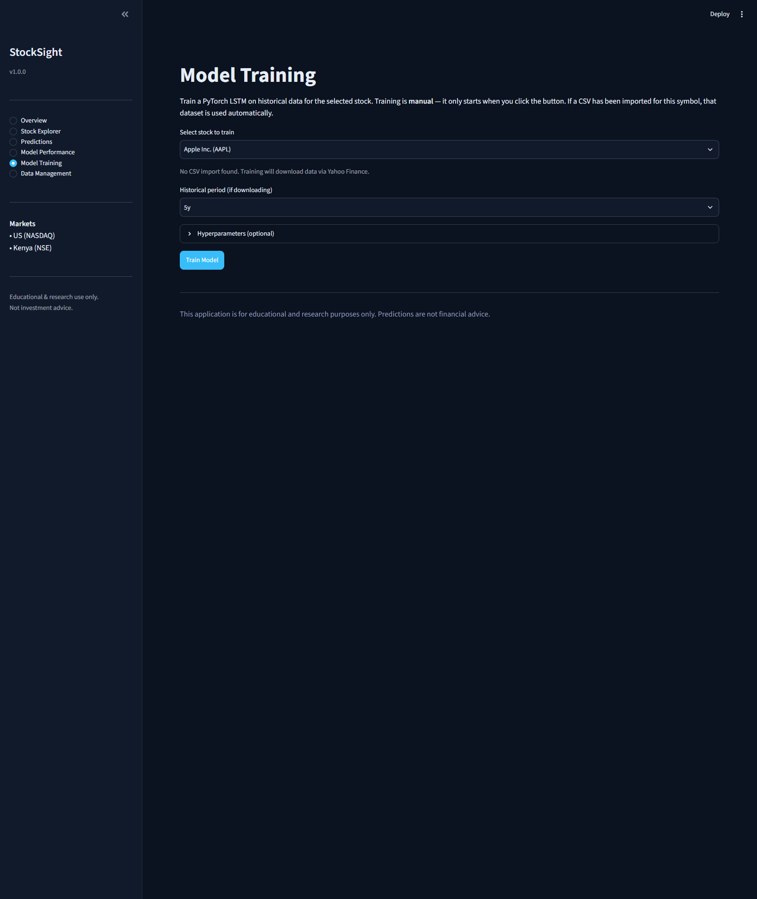
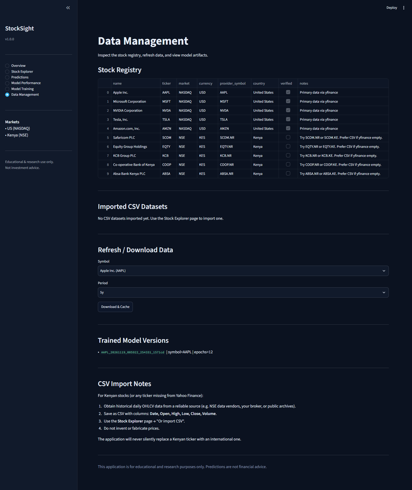
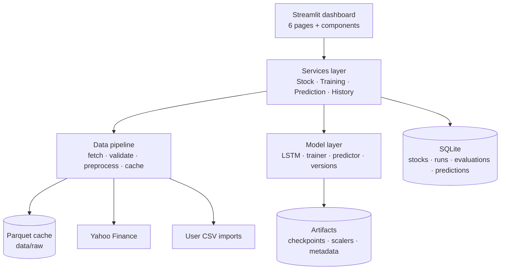

<div align="center">

# StockSight

**An end-to-end, local-first stock forecasting platform built with PyTorch and Streamlit.**

Download historical OHLCV data, train a configurable LSTM, evaluate it against a naive baseline,
and forecast the next trading day's close — all from a polished six-page dashboard.

[](https://www.python.org/)
[](https://pytorch.org/)
[](https://streamlit.io/)
[](#testing)
[](LICENSE)
[](https://github.com/samsonnyaga474/stocksight-lstm/actions/workflows/ci.yml)

[Features](#features) ·
[Screenshots](#screenshots) ·
[Architecture](#architecture) ·
[Methodology](#methodology) ·
[Quick start](#quick-start) ·
[Documentation](#documentation)

</div>



> **Educational project.** StockSight is not financial advice. Markets are noisy and a single-step
> LSTM forecast is a teaching tool, not a trading system. See [Limitations](#limitations).

---

## Contents

- [Why StockSight](#why-stocksight)
- [Features](#features)
- [Screenshots](#screenshots)
- [Architecture](#architecture)
- [Methodology](#methodology)
- [Reference results](#reference-results)
- [Quick start](#quick-start)
- [Usage](#usage)
- [Project structure](#project-structure)
- [Configuration](#configuration)
- [Data sources](#data-sources)
- [Testing](#testing)
- [Security](#security)
- [Limitations](#limitations)
- [Roadmap](#roadmap)
- [Documentation](#documentation)
- [FAQ and troubleshooting](#faq-and-troubleshooting)
- [License](#license)

---

## Why StockSight

Most "stock predictor" repositories stop at a notebook that prints a loss value. StockSight is a
complete application around the model:

- **Reproducible pipeline** — chronological splits, scalers fitted on the training window only,
  sequence windows, early stopping, and versioned artifacts.
- **Honest evaluation** — every run is scored on a held-out test period and compared with a naive
  persistence baseline, with the comparison surfaced in the UI.
- **Real persistence** — SQLite stores stocks, training runs, evaluations, and every forecast so the
  dashboard reflects actual history rather than mocked values.
- **Separation of concerns** — data, modelling, services, persistence, and UI live in independent
  layers; the Streamlit pages contain no model code.
- **One-command setup** on Windows, plus a cross-platform manual path.

## Features

| Area | What you get |
| --- | --- |
| **Data** | Yahoo Finance download with Parquet caching, refresh/force-download, CSV import for any ticker |
| **Universe** | US majors (AAPL, MSFT, NVDA, TSLA, AMZN) and Kenyan NSE names with runtime availability checks |
| **Modelling** | 2-layer PyTorch LSTM, configurable epochs/hidden sizes/learning rate, early stopping, checkpointing |
| **Evaluation** | MAE, RMSE, MAPE, directional accuracy, naive persistence baseline, test-period comparison |
| **Forecasting** | Next-trading-day close with saved scalers and model versioning |
| **Dashboard** | Six pages: Overview, Stock Explorer, Predictions, Model Performance, Model Training, Data Management |
| **Persistence** | SQLite for stocks, runs, evaluations, and prediction history |
| **Quality** | 50 automated tests, compile check, input validation, sanitized exports, FK-safe upserts |
| **UX** | Dark theme, interactive Plotly charts, responsive layout, clear educational disclaimers |

## Screenshots

<table>
  <tr>
    <td width="50%"><strong>Stock Explorer</strong><br/>Download, validate and inspect OHLCV data.<br/></td>
    <td width="50%"><strong>Predictions</strong><br/>Next-day forecast with history and chart overlay.<br/></td>
  </tr>
  <tr>
    <td width="50%"><strong>Model Performance</strong><br/>LSTM vs naive baseline on the held-out test set.<br/></td>
    <td width="50%"><strong>Model Training</strong><br/>Manual, explicit training with optional hyperparameters.<br/></td>
  </tr>
  <tr>
    <td width="50%"><strong>Data Management</strong><br/>Registry, imported datasets, cache, and model artifacts.<br/></td>
    <td width="50%"><strong>Overview</strong><br/>Live counts, recent forecasts and tracked stocks.<br/></td>
  </tr>
</table>

## Architecture



**Layers**

| Layer | Responsibility |
| --- | --- |
| `dashboard/` | Streamlit pages and reusable metric/chart components. No model logic. |
| `src/services/` | Orchestration: load/validate data, run training, persist evaluations, generate forecasts. |
| `src/data/` | Fetching, caching, CSV import, validation, scaling and sequence generation. |
| `src/models/` | LSTM module, dataset, training loop, predictor, and artifact manager. |
| `src/evaluation/` | Metrics, naive baseline, and backtest helpers. |
| `src/database/` | SQLite schema, connection handling, and repositories. |
| `config/` | Stock registry and settings loader. |

**Training flow**

1. Select a stock and start training (explicitly, from the UI).
2. Load cached data or download it; validate and clean the OHLCV frame.
3. Split chronologically 70 / 15 / 15, fit feature scalers on the training rows only.
4. Build 60-step sequences and train the LSTM with early stopping.
5. Save the best checkpoint, scalers, and metadata under a unique version.
6. Score the test period and persist LSTM and baseline metrics.

**Prediction flow**

1. Resolve the latest successful model version for the symbol.
2. Scale the most recent 60 rows with the saved scaler.
3. Run the model in evaluation mode and inverse-transform the output.
4. Persist the forecast and display it against recent price history.

## Methodology

- **Input features** — Open, High, Low, Close, Volume (5 channels).
- **Windowing** — 60 trading days per sample, one-step-ahead target (`Close` at *t+1*).
- **Split** — 70% train, 15% validation, 15% test, strictly chronological with no shuffling.
- **Scaling** — `MinMaxScaler` fitted on the training window only, then applied to validation/test,
  preventing look-ahead leakage.
- **Model** — LSTM (64 → 32 units, dropout 0.2) → linear head; MSE loss, Adam optimizer.
- **Training** — early stopping on validation loss (patience 10), best checkpoint retained.
- **Baselines** — naive persistence (`tomorrow = today`) scored on the same test rows.
- **Metrics** — MAE, RMSE, MAPE and directional accuracy, computed in price units after inverse
  scaling.
- **Directional accuracy (baseline)** — the baseline predicts the direction of the most recent
  observed change. This is a fair persistence rule rather than a trivial constant.

Full details: [`docs/MODEL_DOCUMENTATION.md`](docs/MODEL_DOCUMENTATION.md) and
[`docs/ARCHITECTURE.md`](docs/ARCHITECTURE.md).

## Reference results

A reference run is included to show real, reproducible output — not tuned headline numbers:

| Setting | Value |
| --- | --- |
| Symbol | AAPL |
| Period | 5 years (1,254 rows, 2021-11-19 → 2026-11-18) |
| Split | 877 train / 188 validation / 189 test |
| Epochs | 12 (best epoch 5) |
| Device | CPU |

| Metric | LSTM | Naive baseline |
| --- | ---: | ---: |
| MAE | 27.11 | **3.61** |
| RMSE | 32.70 | **4.95** |
| MAPE | 8.41% | **1.19%** |
| Directional accuracy | **49.74%** | 43.62% |

**Read this honestly:** on this short reference run the naive persistence baseline has much lower
level error, because AAPL trended strongly upward and last-value forecasting tracks a smooth price
level very well. The LSTM captures direction slightly better but lags the trend, so its absolute
error is higher. This is a known and expected outcome for a small, lightly trained model whose
scalers were fitted on the training window; it is reported here deliberately instead of hiding it.
Longer training, additional features, and walk-forward evaluation are natural next steps.

## Quick start

### Windows (recommended)

```powershell
git clone https://github.com/samsonnyaga474/stocksight-lstm.git
cd stocksight-lstm
powershell -ExecutionPolicy Bypass -File .\setup.ps1
powershell -ExecutionPolicy Bypass -File .\run.ps1
```

`setup.ps1` creates `.venv`, installs the CPU build of PyTorch first, installs the remaining
requirements, prepares directories, initialises the database, and verifies imports. `run.ps1`
launches the dashboard at <http://localhost:8501>.

### Manual (any OS)

```bash
python -m venv .venv
# Windows: .venv\Scripts\activate
# macOS/Linux: source .venv/bin/activate
python -m pip install --upgrade pip
python -m pip install torch --index-url https://download.pytorch.org/whl/cpu
python -m pip install -r requirements.txt
streamlit run app.py
```

Requirements: Python 3.11+ (tested on 3.13), roughly 2 GB of free disk space, and internet access
for the first data download. CPU-only PyTorch is sufficient; CUDA works if installed.

## Usage

| Page | What to do |
| --- | --- |
| **Overview** | See stored counts, recent forecasts, and tracked stocks. |
| **Stock Explorer** | Choose a market and symbol, download/cached-load data, import a CSV, validate, and explore charts. |
| **Model Training** | Select a symbol, optionally open hyperparameters, and click **Train Model**. Training is always explicit. |
| **Model Performance** | Compare the latest run's LSTM metrics with the naive baseline and inspect actual vs predicted. |
| **Predictions** | Generate and store a next-day forecast; the chart marks the predicted close. |
| **Data Management** | Inspect the registry, imported CSVs, trained model versions, and refresh cached data. |

**CSV import format** (for Kenyan or any unavailable ticker): a header row with
`Date,Open,High,Low,Close,Volume`. The app validates columns, ordering, and numeric values before
use, and never silently substitutes another ticker.

## Project structure

```text
StockSight/
├── app.py                     # Streamlit entry point and routing
├── config.yaml                # Data, model, training, path and logging settings
├── config/
│   └── stock_registry.py      # US + Kenyan symbol registry
├── dashboard/
│   ├── components/            # Charts and metric helpers
│   └── pages/                 # Six dashboard pages
├── src/
│   ├── data/                  # Fetcher, CSV loader, validator, preprocessor, cache
│   ├── models/                # LSTM, dataset, trainer, predictor, model manager
│   ├── evaluation/            # Metrics, baseline, backtest
│   ├── services/              # Stock, training, prediction, history services
│   ├── database/              # Schema, connection, repositories
│   └── utils/                 # Logging, helpers, exceptions
├── tests/                     # 50 pytest tests
├── docs/                      # Architecture, data sources, install, model docs, screenshots
├── data/                      # raw cache, processed, samples, external imports
├── models/                    # checkpoints, scalers, metadata (artifacts git-ignored)
├── database/                  # SQLite database (git-ignored)
├── logs/
├── setup.ps1 / run.ps1        # Windows automation
├── requirements.txt
└── pytest.ini
```

## Configuration

All defaults live in `config.yaml`:

```yaml
data:
  sequence_length: 60
  train_ratio: 0.70
  val_ratio: 0.15
  test_ratio: 0.15
  features: [Open, High, Low, Close, Volume]

model:
  hidden_size_1: 64
  hidden_size_2: 32
  dropout: 0.2
  learning_rate: 0.001
  batch_size: 32
  max_epochs: 100
  early_stopping_patience: 10
  random_seed: 42
```

The Model Training page can override epochs, batch size, learning rate, hidden sizes, dropout and
sequence length for a single run without editing the file.

## Data sources

- **Yahoo Finance (`yfinance`)** — primary source for supported international symbols. Data is
  cached in `data/raw` as Parquet with metadata for fast reloads.
- **CSV imports** — recommended fallback for Nairobi Securities Exchange tickers and any symbol
  Yahoo Finance does not serve. See [`docs/DATA_SOURCES.md`](docs/DATA_SOURCES.md).

Kenyan symbols are registered with best-known suffixes (`.NR`, `.KE`) but availability changes over
time. If a download returns no rows, StockSight reports it and expects a CSV import — it will never
quietly map a Kenyan ticker to an unrelated international one.

## Testing

```bash
.venv\Scripts\python.exe -m compileall -q src dashboard tests config app.py   # Windows
.venv\Scripts\python.exe -m pytest tests/ -q
```

Current status: **50 tests passing** (535 s on the reference CPU-only machine).

Coverage includes data validation and cache behaviour, preprocessing leakage guards, model
save/load round trips, metric correctness, baseline persistence logic, repository relationships,
service orchestration, and release-quality checks (no stray debug code, consistent versioning,
documentation presence).

## Security

- Runs **locally**; no accounts, no cloud calls other than Yahoo Finance, no telemetry.
- SQL uses parameterized queries; identifiers and CSV exports are sanitized.
- CSVs are validated before use, and uploaded files are size-limited by the dashboard.
- Torch checkpoints are loaded with `weights_only=True`.
- No secrets are committed; `config.yaml` contains no credentials and
  `.streamlit/secrets.toml` is git-ignored.
- Model artifacts, caches, logs, and the SQLite database are git-ignored by design.

If you deploy this beyond your machine, put it behind authentication and HTTPS, and restrict
outbound network access.

## Limitations

- **Single-step forecasting.** The model predicts one trading day ahead; it is not a long-horizon
  price simulator.
- **Train-only scaling.** `MinMaxScaler` is fitted on the training window, so forecasts are bounded by
  the training range and cannot extrapolate a strong trend beyond it. The reference run shows this
  clearly (predicted −16.76% while the test trend was upward).
- **No feature engineering beyond OHLCV.** No technical indicators, macro data, or sentiment.
- **Small reference training budget.** The included demo uses 12 epochs; results improve with a
  proper tuning and walk-forward protocol, but are still not investment-grade.
- **Baseline can win on level error.** Low-volatility, trending series favour persistence; always
  compare before drawing conclusions.
- **Data availability.** Kenyan NSE symbols are often unavailable from Yahoo Finance and require
  CSV imports; timestamps and adjustments depend on the provider.
- **Local single-user app.** No login, multi-tenancy, or production hardening.
- **Windows-first automation.** `setup.ps1`/`run.ps1` target Windows; manual steps work elsewhere.

## Roadmap

- [ ] Walk-forward / rolling-origin backtesting with transaction-cost awareness
- [ ] Feature set expansion (returns, volatility, technical indicators, volume profiles)
- [ ] Hyperparameter search and experiment tracking
- [ ] Multi-step forecasting with uncertainty intervals
- [ ] Docker image and one-command cloud deployment
- [ ] Optional authentication for shared deployments
- [ ] Additional markets and data providers

## Documentation

| Document | Contents |
| --- | --- |
| [`docs/INSTALLATION.md`](docs/INSTALLATION.md) | Detailed setup, environment notes, first run |
| [`docs/ARCHITECTURE.md`](docs/ARCHITECTURE.md) | Layers, data flow, package responsibilities |
| [`docs/MODEL_DOCUMENTATION.md`](docs/MODEL_DOCUMENTATION.md) | Model design, training, evaluation, artifacts |
| [`docs/DATA_SOURCES.md`](docs/DATA_SOURCES.md) | Supported sources, Kenyan market notes, CSV format |

## FAQ and troubleshooting

**The first page load is slow.** Importing PyTorch and warming Streamlit takes several seconds on
CPU-only machines; later navigations are faster. The app avoids heavyweight imports on page paths
that do not need them.

**A Kenyan ticker returns no data.** Yahoo Finance does not consistently serve NSE symbols. Export a
CSV with `Date,Open,High,Low,Close,Volume` and import it on the Stock Explorer page.

**Why is the baseline error lower than the LSTM?** Persistence is very strong on smooth, trending
series. The test period rewards last-value forecasts; the LSTM is a small model on a short run. See
[Reference results](#reference-results).

**Where are my models and forecasts stored?** Checkpoints, scalers, and metadata are under `models/`;
runs and forecasts are in `database/stocksight.db`. Both are git-ignored.

**Can I change the lookback window?** Yes — set `data.sequence_length` in `config.yaml` or override
it in the Model Training page. It must remain smaller than the smallest split.

**Do I need a GPU?** No. CPU-only PyTorch is the default install path; CUDA is used automatically if
present and configured.

## License

Released under the [MIT License](LICENSE).

<div align="center">

**Built for learning, evaluated honestly.**

If you use StockSight in coursework or research, please cite the repository.

</div>
